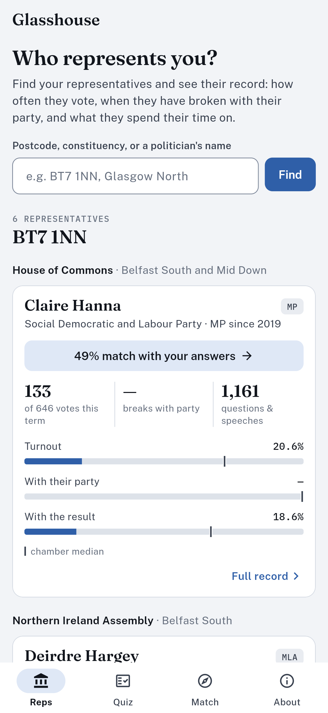
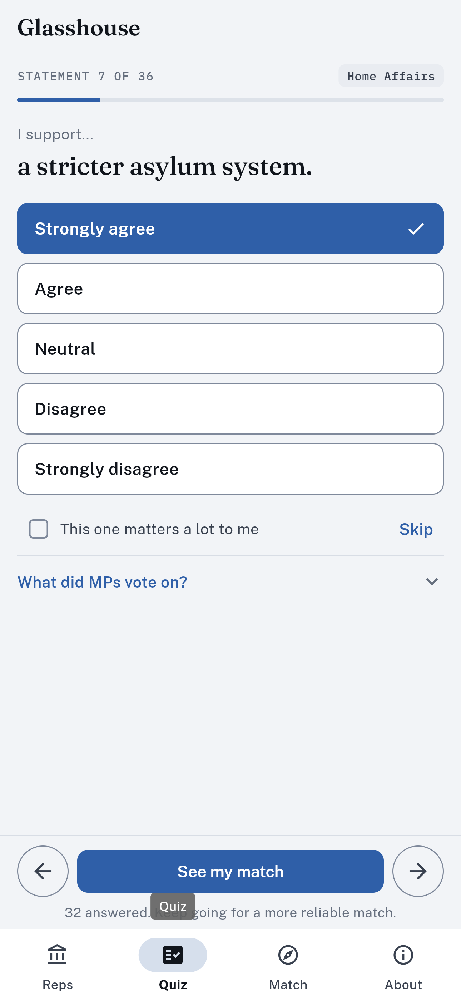
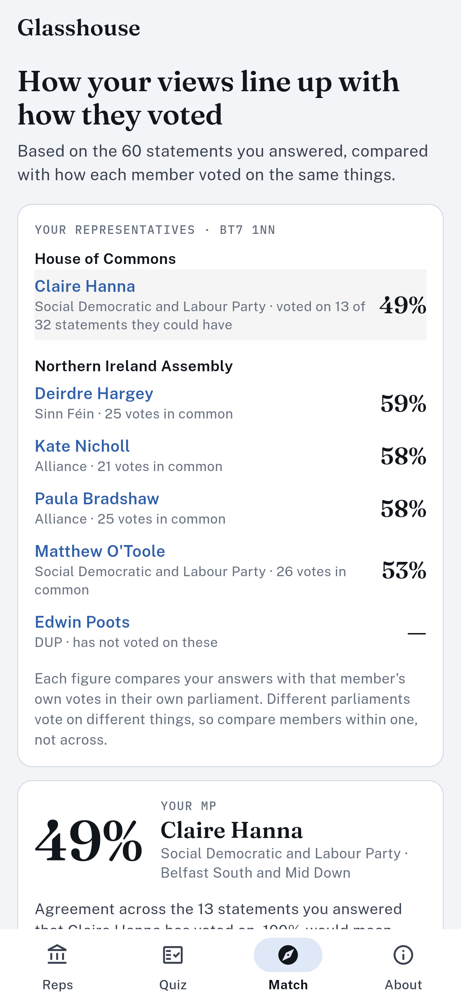
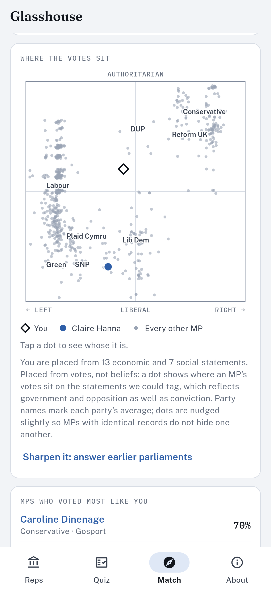

# Glasshouse for Android and iPhone

The Glasshouse app, written in Flutter: one codebase that builds for Android,
iPhone and iPad. It does what the website does — find your representatives,
see their record, take the quiz, see how your answers line up with how each
of them voted, in each parliament — and works without a connection once
installed.

<p>
  
  
  
  
</p>

## Try it on an Android phone

Every change to the app is built automatically. On GitHub open **Actions →
mobile**, pick the latest run with a green tick, and download
**glasshouse-android** from the bottom of the page (you need to be signed in
to GitHub). Unzip it, copy `app-release.apk` to your phone and open it; Android
will ask you to allow installing from that source.

That build is for trying the app out. It is signed with a throwaway key, so
Google Play will not accept it — see [Releasing](#releasing-on-google-play).

## Work on it

Install [Flutter](https://docs.flutter.dev/get-started/install) 3.50 or newer, then:

```sh
cd mobile
flutter pub get
flutter run            # on a connected phone or an emulator
flutter test           # 122 tests, about a minute
flutter analyze
flutter test integration_test   # drives the real app on the attached phone
```

| Where | What |
| --- | --- |
| `lib/core/` | Data, scoring, postcode lookup, saved answers. No screens. |
| `lib/ui/` | The four screens, the compass, the full-record page, and `local.dart`: elections and councillors for a place. |
| `lib/theme.dart` | Colours and type, light and dark. |
| `assets/data/` | The two data files the app ships with. |
| `test/` | Unit tests and tests that drive the whole app. |
| `integration_test/` | The same, on a real phone or emulator, with nothing faked. |
| `tool/make_icons.py` | Redraws the app icon at every size. |

### The same numbers as the website

The match percentage, when it is shown and when it is ranked, the compass
and the order the statements are asked in are computed by
`lib/core/scoring.dart`. The reference for all of it is
`analysis/quizmath.py` in the repository root, which the website follows too.
`python -m analysis.quizmath` writes `test/fixtures/quiz_slice.json`: a frozen
slice of real MPs, sitting and former, with the results the reference gives.
`test/scoring_test.dart` must reproduce every number in it, so the app and
the website cannot quietly drift apart. If you change how anything is scored,
change the reference first, regenerate the slice, then make this file and
`app/index.html` agree with it.

### Tests that do not depend on today's news

Elections come and go, so the tests do not rely on which ones are in the
register on the day the data was built. `test/support.dart` adds an invented
ward, with a by-election and a council, to the real data; the tests for
elections, candidates and councillors use that.

### Keeping the data fresh

`python -m analysis.build` (in the repository root) rebuilds the data and
copies it into `mobile/assets/data/`. That copy is what a new install starts
with.

Votes change daily and a shop release takes days, so the app also looks for
newer data itself: at most twice a day it downloads `app/data.json` and
`app/quiz.json` from this repository's default branch, checks the two files
belong together, and uses them from the next launch. So to update every
installed copy, run the build and push — no new release is needed. The address
is `kRemoteBase` in `lib/core/repository.dart`; set it to an empty string to
turn this off.

## Before you publish

These are yours to decide or do; none of them can be done from here.

- **The app's permanent ID.** It is `io.github.coneill823.glasshouse` on both
  platforms. Neither shop lets you change it after the first upload. To use
  your own domain instead (say `uk.co.example.glasshouse`), change it in
  `android/app/build.gradle.kts` (`namespace` and `applicationId`), move
  `android/app/src/main/kotlin/io/github/coneill823/glasshouse/MainActivity.kt`
  to the matching folder and fix its `package` line, and replace it in
  `ios/Runner.xcodeproj/project.pbxproj`.
- **A privacy policy at a public address.** Both shops require one.
  [`docs/PRIVACY.md`](../docs/PRIVACY.md) is a draft that describes exactly
  what this app does; add your name and contact details and publish it on your
  website.
- **Say it is independent.** Google Play requires apps that present government
  information to name their sources and state that they do not represent a
  government body. The About screen already does; put the same sentence and
  the source links in the shop description.
- **mySociety's terms.** The votes are CC BY 4.0, which permits this with the
  credit the app already gives. Their policy groupings — the mapping of votes
  to quiz statements — carry no explicit licence that we could find, so ask
  them before launch (see `docs/METHODS.md`).
- **Democracy Club's terms.** Elections and candidates are CC BY 4.0, credited
  on the About screen and on every ballot. Their data covers real people
  standing for office, so tell them what you are building before launch, and
  read the section of the privacy draft on people who appear in the app: as
  the publisher you would be the one answering a candidate or councillor who
  says something shown about them is wrong.
- **The councils.** Councillors and attendance are read from two councils' own
  public committee pages. That is a trial; before a public launch, ask each
  council you include.
- **Shop listing.** A name, descriptions, a category and a support email.
  [`store/listing.md`](store/listing.md) is a draft of the wording, and
  [`store/`](store/) holds the icons, the Play banner and screenshots at the
  sizes each shop asks for. `python3 tool/make_icons.py` and
  `node tool/screenshots.js` remake them.

## Releasing on Google Play

1. Open a [Play Console](https://play.google.com/console) developer account
   (a one-off US$25, plus identity checks). Personal accounts opened since
   late 2023 must run a closed test with a set number of testers for two weeks
   before they may publish to everyone; the Console tells you the current rule.
2. Make the key that will sign your uploads. Keep the file and its passwords
   somewhere safe and backed up, and never commit them:
   ```sh
   keytool -genkey -v -keystore ~/glasshouse-upload.jks \
     -keyalg RSA -keysize 2048 -validity 10000 -alias upload
   ```
3. Tell the build where it is, in a new file `mobile/android/key.properties`
   (already ignored by git):
   ```properties
   storePassword=the password you chose
   keyPassword=the password you chose
   keyAlias=upload
   storeFile=/home/you/glasshouse-upload.jks
   ```
4. Build the bundle Play wants:
   ```sh
   flutter build appbundle --release
   ```
   It is written to `build/app/outputs/bundle/release/app-release.aab`.
5. In the Console create the app, accept Play App Signing, and upload the
   bundle to **Internal testing** first. Fill in the content rating, target
   audience (adults) and Data safety forms. For Data safety, the facts are:
   the app has no accounts, adverts or analytics; quiz answers stay on the
   device; the one thing that leaves it is a postcode the user types, sent
   over HTTPS to postcodes.io to find their constituency, and only if they
   search by postcode.
6. For every later upload, raise the version in `pubspec.yaml`. In
   `version: 1.0.0+1` the part after `+` must go up each time.

## Releasing on the App Store

Signing and uploading an iPhone app needs Apple's tools, which only run on a
Mac. If you do not have one, a hosted Mac build service does the same job
(Codemagic is built around Flutter; GitHub's macOS runners also work).

1. Join the [Apple Developer Program](https://developer.apple.com/programs/)
   (US$99 a year).
2. In [App Store Connect](https://appstoreconnect.apple.com) create the app
   with the bundle ID above.
3. On the Mac, open `ios/Runner.xcworkspace` in Xcode, select **Runner →
   Signing & Capabilities**, and choose your team.
4. Build and upload:
   ```sh
   flutter build ipa --release
   ```
   then send `build/ios/ipa/*.ipa` with Apple's Transporter app.
5. Try it through TestFlight, complete the privacy questions with the same
   facts as above, and submit for review.

Each push already proves the iPhone app builds and runs: the **ios** job in
the **mobile** workflow builds it unsigned, then drives it on an iPhone
simulator.

## What it does not do yet

- A Welsh postcode finds your MP but not your Senedd constituency; search for
  that by name. (postcodes.io, which the app uses, does not return Senedd
  seats.)
- The questions for the Scottish Parliament, the Senedd and the Assembly are
  single votes, most of them on motions that express a view; the About screen
  says what that is worth. Members first elected in May 2026 have too few
  votes to be matched yet, and the Senedd's questions have titles but not the
  motion's wording.
- Candidates are listed and never scored. Councillors are shown for two
  councils only, by name, party and attendance.
- Looking a postcode up on a real phone over a real connection has not been
  tried by anyone yet. The automated tests use a stand-in for the lookup
  service; the first thing to try on your own phone is your own postcode.
- English only.
